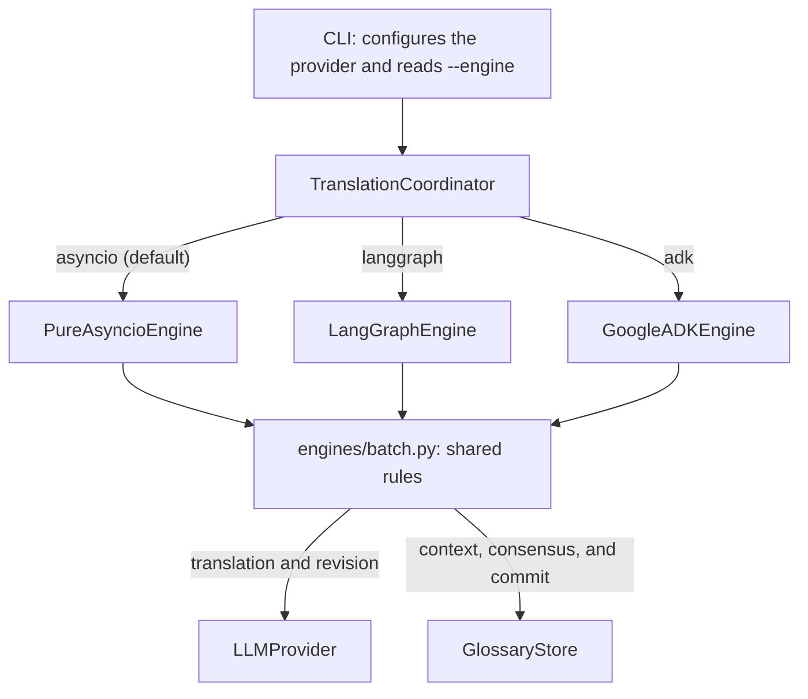
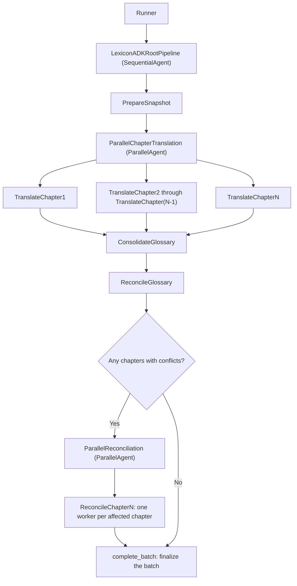
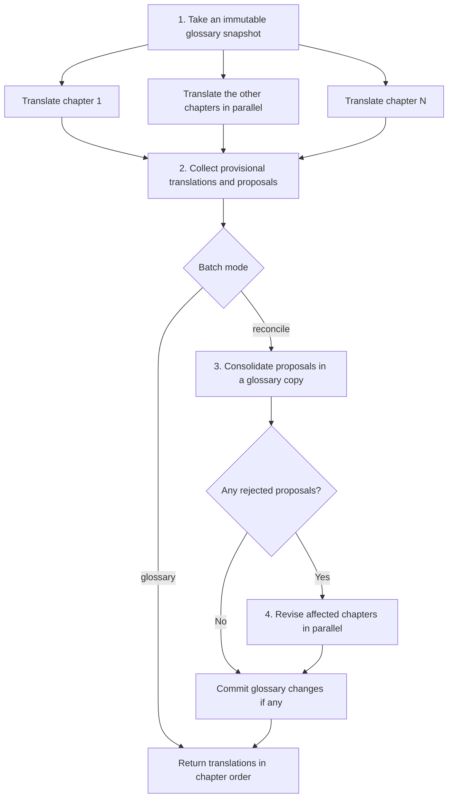

# Lexicon: Context-Aware Book Translation Pipeline with Lexical Consensus
> **Context-Aware Book Translation Pipeline with Lexical Consensus**  
> *(Name Origin: **Lexi**con = **Lexi**cal **Con**sensus)*

**Author** — Dangeles Lima

[](README.en.md)
[](README.md)
[](https://www.python.org/)
[](tests/)
[-purple.svg)](https://www.gutenberg.org/ebooks/55)

An asynchronous, parallel translation pipeline for entire books (EPUB / Markdown $\rightarrow$ PT-BR) engineered to resolve the two classic failure modes of machine translation systems and zero-shot LLMs on long documents:

1. **Cross-Chapter Lexical Drift**: In long works translated in parallel without shared state, identical worldbuilding terms receive divergent translations across chapters (e.g., *Wizard* $\rightarrow$ *bruxo* in ch. 1, *mago* in ch. 12, *sábio* in ch. 18; *Golden Cap* $\rightarrow$ *gorrete de ouro* vs. *chapéu dourado*).
2. **Cross-Document Coreference & Gender Agreement**: English does not mark grammatical gender on common nouns, titles, and predicative adjectives (*"the ruler of the South was patient"*, *"the counselor of the North was cautious"*, *"the young traveler was exhausted"*). Translation systems lacking cross-chapter entity memory systematically default to the masculine gender in Portuguese (*"o governante foi paciente"*, *"o jovem viajante estava exausto"* for female characters like Glinda and Dorothy).

Demonstrated and evaluated on the public domain corpus ***The Wonderful Wizard of Oz* (L. Frank Baum, 1900 — Project Gutenberg #55)**.

---

## Table of Contents

- [Name Origin: Why "Lexicon"?](#name-origin-why-lexicon)
- [Modular architecture and interchangeable engines](#modular-architecture-and-interchangeable-engines)
- [The 4-Phase Consensus Protocol](#the-4-phase-consensus-protocol)
- [Why Symbolic RAG Outperforms Vector RAG for Glossaries](#why-symbolic-rag-outperforms-vector-rag-for-glossaries)
- [Repository Structure](#repository-structure)
- [Multi-Engine Benchmark Results (Ablation Study)](#multi-engine-benchmark-results-ablation-study)
- [How to Run](#how-to-run)
- [Industrial Applications Beyond Books](#industrial-applications-beyond-books)
- [Slide Decks (Meetup & Technical Interviews)](#slide-decks-meetup--technical-interviews)

---

## Name Origin: Why "Lexicon"?

The name **Lexicon** is a software engineering portmanteau:
$$\text{\textbf{Lexi}con} = \textbf{Lexi}\text{cal } \textbf{Con}\text{sensus}$$

Unlike naive approaches that rely on a single massive context window or slow sequential chapter-by-chapter processing, **Lexicon** models book coherence as a **lexical consensus problem**. Chapters are translated concurrently from the same immutable glossary snapshot. A single consolidation step establishes canonical terminology.

---

## Modular architecture and interchangeable engines

Lexicon is a modular Python application inspired by **ports and adapters**. The model integration follows this pattern. Engines call the `LLMProvider` protocol defined in `contracts.py`, and the CLI supplies an adapter for the OpenAI-compatible API or LM Studio.

- **Domain.** `models.py` defines the pipeline data. `glossary.py` retrieves lexical context and resolves terminology conflicts. `evals.py` computes evaluation metrics.
- **Coordination.** `cli.py` parses options and configures the provider. The `TranslationCoordinator` in `pipeline.py` instantiates the concrete engine selected by `--engine` and delegates the batch to it.
- **Orchestration.** `engines/batch.py` holds the shared logic for translation, consolidation, reconciliation, and result assembly. Each engine schedules these steps with its own concurrency mechanism.
- **EPUB.** `translate_epub.py` coordinates extraction, translation, and reconstruction. The `epub/` package manages the `_chapters.json` map, paragraph alignment, and book assembly.

`asyncio` is the default engine and uses semaphores and `asyncio.gather`. `langgraph` uses a `StateGraph` with dynamic chapter dispatch via `Send()`. `adk` organizes the steps with sequential and parallel agents. LangGraph and ADK have local fallback implementations for environments without the corresponding extras. `--concurrency` limits simultaneous provider calls within a batch for all three engines.

### How the coordinator selects an engine



### Google ADK agent hierarchy

The `Runner` executes the root agent. For a batch of N chapters, ADK creates N translation agents, one per chapter. Up to `min(N, --concurrency)` agents can call the model at the same time. Consolidation starts after all agents publish their results to the session state.



---

## The 4-Phase Consensus Protocol

1. **Prepare.** The engine takes an immutable glossary snapshot. With context injection enabled, symbolic retrieval selects the terms and characters found in each chapter.
2. **Translate in parallel.** The provider returns a provisional translation and may propose glossary terms.
3. **Consolidate.** Proposals are grouped by normalized source term. An existing canonical entry takes precedence. For a new term, the proposal from the lowest-numbered chapter wins. Changes are staged in a copy of the glossary.
4. **Reconcile.** The engine revises only chapters with rejected proposals and commits glossary changes after revision succeeds.

The `glossary` mode keeps the glossary fixed and runs the first two steps.



---

## Why Symbolic RAG Outperforms Vector RAG for Glossaries

Dense embedding models place synonyms, antonyms, and co-hyponyms in the same geometric neighborhood (*wizard*, *mage*, *sorcerer*, and *witch* exhibit cosine similarity $> 0.90$). Querying glossaries via dense vector search causes semantic collision, contaminating the prompt with forbidden synonyms.

`GlossaryStore` employs **deterministic symbolic retrieval with morphological expansion** (`english_inflections` and `portuguese_inflections`):
* **Zero Synonym Collision**: Co-hyponyms remain strictly orthogonal.
* **Context Token Reduction (-85%)**: Filters a glossary of thousands of terms down to the 15–25 active entities per chapter.
* **Sub-Millisecond Latency**: Runs entirely in memory in $< 1\text{ ms}$ per chapter without embedding API calls or vector index overhead.

---

## Repository Structure

```text
lexicon/
├── pyproject.toml
├── benchmarks/
├── docs/
├── examples/
├── output/
├── slides/
├── source/
├── tests/
└── src/lexicon/
    ├── cli.py
    ├── config.py
    ├── contracts.py
    ├── dataset.py
    ├── evals.py
    ├── glossary.py
    ├── local_consensus.py
    ├── local_translation.py
    ├── models.py
    ├── pipeline.py
    ├── translate_epub.py
    ├── engines/
    │   ├── batch.py
    │   ├── pure_asyncio.py
    │   ├── langgraph_engine.py
    │   ├── adk_engine.py
    │   ├── _langgraph_fallback.py
    │   └── _adk_fallback.py
    ├── epub/
    │   ├── alignment.py
    │   ├── builder.py
    │   ├── chapter_mapping.py
    │   ├── extractor.py
    │   ├── reflow.py
    │   └── xhtml.py
    └── providers/
        ├── local.py
        └── openai_compatible.py
```

The source EPUB is in `source/`, the translated sample is in `output/`, and the Oz glossary is in `examples/`. Benchmark and evaluation scripts are in `benchmarks/`.

---

## Multi-Engine Benchmark Results (Ablation Study)

The `python3 benchmarks/run_benchmark.py` command uses a simulated provider and three short test passages inspired by *The Wonderful Wizard of Oz*. The translations and token counts in this table are fixed.

```text
======================================================================================================
BENCHMARK MULTI-ENGINE (THE WONDERFUL WIZARD OF OZ, 1900) — CONSISTÊNCIA, GÊNERO & CHRF
======================================================================================================
Configuração & Engine                       | Aderência | Drift (H) |   Gênero |   chrF |  Tokens
------------------------------------------------------------------------------------------------------
1. Stateless Zero-Shot (Baseline)           |     25.0% | 1.5850 b |     0.0% |  84.32 |    1635
2. Static Context (Sem Reconciliação)       |     83.3% | 0.3962 b |   100.0% |  97.15 |    2175
3. Lexicon 4-Phase [Pure Asyncio]           |    100.0% | 0.0000 b |   100.0% | 100.00 |    3025
4. Lexicon 4-Phase [LangGraph StateGraph]   |    100.0% | 0.0000 b |   100.0% | 100.00 |    3025
5. Lexicon 4-Phase [Google ADK Hierarchy]   |    100.0% | 0.0000 b |   100.0% | 100.00 |    3025
======================================================================================================
```

### Local Gemma 4 in LM Studio

The local benchmark uses the same three passages and Brazilian Portuguese references. All three models receive the same prompts, seed glossary, and character profiles. The `asyncio` engine translates the passages with that context, with reconciliation disabled. The test uses temperature 0.2, one request at a time, a 3,072-token output limit per request, and JSON schema responses.

To reproduce, start the LM Studio server on port 1234 and load one model at a time with an 8,192-token context window. From the project root, pass the identifier shown by `lms ps` to the script:

```bash
lms server start
lms load google/gemma-4-e4b -c 8192 --parallel 1
python3 benchmarks/run_benchmark.py --lm-studio-model google/gemma-4-e4b
lms unload google/gemma-4-e4b
```

Repeat for `google/gemma-4-12b` and `google/gemma-4-26b-a4b-qat`. Wall time covers the batch with the model already loaded.

**Local results (November 12, 2026)**

One run per model on an Apple M5 with 24 GB of memory, LM Studio 0.4.25+1, and 4-bit models. Zero drift means no variation among forms recognized by the evaluator. Read it alongside adherence, since the evaluator excludes unknown variants from drift.

| Model | Adherence | Drift (bits) | Gender | chrF | Tokens | Wall time (s) |
| --- | ---: | ---: | ---: | ---: | ---: | ---: |
| Gemma 4 E4B | 75.0% | 0.0000 | 100.0% | 87.39 | 2200 | 16.81 |
| Gemma 4 12B | 66.7% | 0.0000 | 57.1% | 85.26 | 2212 | 27.49 |
| Gemma 4 26B A4B QAT | 58.3% | 0.0000 | 57.1% | 69.68 | 2175 | 21.40 |

All three models returned valid JSON for all three passages. Reviewing the outputs showed that the 26B translated the third title but left both paragraphs in English. The 12B left an English word in the second passage, and the E4B changed a cap into a crown in the third. JSON validation and the metrics in the table do not establish complete or faithful translation.

The E4B had the highest glossary adherence and chrF in this exploratory run. Comparing literary translation quality requires full chapters, repeated runs, and a blind review of coverage, fidelity, and fluency.

### Evaluation Metric Formulations

* **Glossary Adherence Rate (GAR %)**:
  $$\text{GAR} = \frac{\text{Correctly Translated Canonical Terms}}{\text{Total Glossary Entity Mentions}} \times 100$$
* **Shannon Entropy of Lexical Drift ($H(T \mid S)$ in bits)**:
  $$H(T \mid S = s) = -\sum_{t \in \mathcal{V}(s)} p(t \mid s) \log_2 p(t \mid s)$$
  *A score of $0.0000\text{ bits}$ indicates that the evaluator found no variation among the forms it recognizes.*
* **chrF (Popović, 2015)**: Character $n$-gram F-score ($n \in \{1..6\}$, $\beta = 2$), standard MT metric for morphologically rich target languages like Portuguese.

---

## How to Run

### 0. API Keys & Model Configuration (.env)

Lexicon is **completely model- and provider-agnostic**. It features a built-in zero-dependency `.env` file loader. To configure your preferred LLM provider, copy the template and edit it:

```bash
cp lexicon/.env.example lexicon/.env
```

#### Supported Providers & Models

| Provider / Runtime | Default Endpoint | Recommended Model | How to Configure in `.env` |
| :--- | :--- | :--- | :--- |
| **LM Studio (Local / Free)** | `http://localhost:1234/v1` | `google/gemma-4-e4b` | `LLM_BASE_URL=http://localhost:1234/v1`<br>`LLM_API_KEY=lm-studio`<br>`LLM_MODEL=google/gemma-4-e4b` |
| **Ollama (Local / CLI)** | `http://localhost:11434/v1` | `llama3.3:70b` / `qwen2.5:32b` | `LLM_BASE_URL=http://localhost:11434/v1`<br>`LLM_API_KEY=ollama`<br>`LLM_MODEL=llama3.3:70b` |
| **OpenAI (Cloud)** | `https://api.openai.com/v1` | `gpt-4o-mini` *(default)* / `gpt-4o` | `OPENAI_API_KEY=sk-...`<br>`LLM_MODEL=gpt-4o-mini` |
| **Google Gemini (Cloud)** | `https://generativelanguage.googleapis.com/v1beta/openai` | `gemini-2.5-flash` | `GEMINI_API_KEY=AIzaSy...`<br>`LLM_MODEL=gemini-2.5-flash` |
| **OpenRouter / DeepSeek** | `https://openrouter.ai/api/v1` | `deepseek/deepseek-chat` | `LLM_API_KEY=sk-or-...`<br>`LLM_BASE_URL=https://openrouter.ai/api/v1` |

> [!NOTE]
> **Offline Deterministic Benchmark:** Without `--lm-studio-model`, the script uses a simulated provider and runs without a model server. The LM Studio mode uses local inference.

---

### 1. Unit & Multi-Engine Integration Tests
```bash
PYTHONPATH=src python3 -m unittest discover -s tests -v
```

### 2. Multi-Engine Benchmark Execution
```bash
python3 benchmarks/run_benchmark.py
```

### 3. Direct EPUB Book Translation (All-in-One Standalone Command)

The `translate-epub` command extracts a book, translates sections in parallel, and builds a new EPUB. In LM Studio mode, the model receives one paragraph per request with the section glossary and returns Portuguese text. Longer paragraphs are split. Lexicon checks for empty, truncated, and copied output and retries when needed. Every model uses the same workflow. Accepted paragraphs return to the original XHTML order.

```bash
# Local translation with Gemma E4B. Run from the project root.
lms server start
lms load google/gemma-4-e4b -c 8192 --parallel 2
PYTHONPATH=src python3 -m lexicon.cli translate-epub \
  source/wizard_of_oz.epub -o output/wizard_of_oz_pt.epub \
  --lm-studio --model google/gemma-4-e4b --concurrency 2 \
  --glossary examples/oz_glossary.md --title "O Maravilhoso Mágico de Oz"

# Complete EPUB translation via OpenAI / Gemini (configured in .env):
PYTHONPATH=src python3 -m lexicon.cli translate-epub \
  source/wizard_of_oz.epub \
  -o output/wizard_of_oz_pt.epub \
  --engine langgraph

# Modular granular operations:
PYTHONPATH=src python3 -m lexicon.cli extract source/wizard_of_oz.epub -o en/wizard_of_oz
PYTHONPATH=src python3 -m lexicon.cli translate --source-dir en/wizard_of_oz --output-dir pt/wizard_of_oz --glossary pt/wizard_of_oz/glossary.md
PYTHONPATH=src python3 -m lexicon.cli build-epub pt/wizard_of_oz -o output/wizard_of_oz_pt.epub -s source/wizard_of_oz.epub
```

In a Python virtual environment, install the project with `python3 -m pip install -e .` and use the model identifier shown by `lms ps`. Add `--sections 3 5` to translate chapters I–III of this EPUB. Its first two sections are the opening material and introduction. Local translation defaults to `--mode glossary`. Add `--mode reconcile --glossary examples/oz_glossary.md` to detect terminology conflicts and revise affected paragraphs in the same command. Set `--concurrency` to match the number of simultaneous generations configured in LM Studio.

The default engine is `asyncio`. Install `.[langgraph]` or `.[adk]` to try the experimental native engines. The CLI and simulated benchmark identify fallback runs.

The short-passage benchmark above measures the earlier provider. The EPUB demo uses paragraph translation.

Gemma 4 E4B, 12B, and 26B A4B QAT translated chapter I with the same workflow, glossary, temperature of 0.2, and 8,192-token context window. E4B produced the [Portuguese sample](output/wizard_of_oz_amostra_pt.epub) of chapters I–III in **3 min 16 s** on an Apple M5 with 24 GB of memory and two workers. We checked all 135 paragraphs in the final EPUB, along with the headings, table-of-contents links, and publication language.

---

### Three full chapters benchmark in LM Studio

Three complete chapters, with 135 paragraphs per output. All models used LM Studio, asyncio, two workers, temperature 0.2, and an 8,192-token context window. The benchmark ran on an Apple M5 with 24 GB, with one 4-bit model loaded at a time.

```text
===============================================================================================================
BENCHMARK LM STUDIO / GEMMA 4 — OZ I–III — ASYNCIO, 2 WORKERS
===============================================================================================================
Gemma 4      | Configuration        | Adherence |    Drift |          Gender |   chrF |  Tokens |  Time (s)
---------------------------------------------------------------------------------------------------------------
E4B          | Stateless Zero-Shot  |    41.67% | 0.5765 b |      100% (7/7) |  71.69 |   21483 |    192.22
E4B          | Static Context       |    91.67% | 0.0000 b |      100% (8/8) |  72.38 |   39829 |    197.52
E4B          | Lexicon 4-Phase      |    91.67% | 0.0000 b |      100% (8/8) |  72.38 |   40799 |    202.27
12B          | Stateless Zero-Shot  |    41.67% | 0.7289 b |      100% (8/8) |  72.79 |   22170 |    327.63
12B          | Static Context       |    91.67% | 0.0000 b |      100% (9/9) |  72.69 |   40567 |    349.39
12B          | Lexicon 4-Phase      |    91.67% | 0.0000 b |      100% (9/9) |  72.69 |   41558 |    357.51
26B A4B QAT  | Stateless Zero-Shot  |    58.33% | 0.2403 b |      100% (8/8) |  73.51 |   22243 |    172.77
26B A4B QAT  | Static Context       |    95.83% | 0.0000 b |      100% (7/7) |  73.88 |   40647 |    184.90
26B A4B QAT  | Lexicon 4-Phase      |   100.00% | 0.0000 b |      100% (7/7) |  73.87 |   41456 |    202.96
===============================================================================================================
```

Zero-Shot translates without a glossary. Static Context uses the fixed glossary. 4-Phase starts from Static Context, collects observed terminology, consolidates proposals, and revisits affected paragraphs. Its tokens and wall time include Static Context and the additional pass, including EPUB assembly in both. E4B, 12B, and 26B each recorded one conflict. Only the 26B improved its adherence after revision, from 23/24 to 24/24.

Adherence uses 24 paragraph–term pairs. Drift is mean Shannon entropy across observed term variants, with at least 22 of 24 occurrences recognized per row. Gender shows correct cases out of those with a recognized marker at nine annotated points. chrF averages the three chapters without headings or captions, against Rodrigo Pasa's translation. [Livris — O Mágico de Oz](https://livris.com.br/livros/o-magico-de-oz/)

Use the same model and options for the first two runs. For Zero-Shot, omit the glossary and use a fresh work directory. The third command reads the Markdown chapters from Static Context.

```bash
MODEL=google/gemma-4-e4b
lms server start
lms load "$MODEL" -c 8192 --parallel 2
COMMON=(source/wizard_of_oz.epub --model "$MODEL" --sections 3 5 --concurrency 2 --temperature 0.2)
GLOSSARY=examples/oz_glossary.md
time env PYTHONPATH=src python3 -m lexicon.cli translate-epub --lm-studio "${COMMON[@]}" \
  --work-dir /tmp/oz-zero -o /tmp/oz-zero.epub
time env PYTHONPATH=src python3 -m lexicon.cli translate-epub --lm-studio "${COMMON[@]}" \
  --glossary "$GLOSSARY" --work-dir /tmp/oz-static -o /tmp/oz-static.epub
time python3 benchmarks/reconcile_epub.py /tmp/oz-static/pt "${COMMON[@]}" \
  --glossary "$GLOSSARY" --work-dir /tmp/oz-four -o /tmp/oz-four.epub
curl -fL https://livris.com.br/download/o-magico-de-oz.epub -o /tmp/oz-reference.epub
python3 benchmarks/score_oz_matrix.py source/wizard_of_oz.epub /tmp/oz-four.epub \
  /tmp/oz-four/pt/_chapters.json "$GLOSSARY" /tmp/oz-reference.epub
lms unload "$MODEL"
```

---

## Online Demo & BYOK Roadmap

The complete architectural plan for deploying the application as a live web showcase (with SSE streaming, cost guardrails, and **BYOK — *Bring Your Own Key*** support) is documented in:
👉 [**Online Demo Architecture Guide (with BYOK)**](docs/online_demo_architecture.md)

---

## Industrial Applications Beyond Books

Translating full-length literature is merely the most accessible, mathematically verifiable demonstration of the consensus protocol. The same architecture of **Snapshot Isolation + AI Map-Reduce + Deterministic Reconciliation** directly solves mission-critical enterprise engineering challenges:

1. **Large-Scale Codebase Refactoring**: Monolith migrations or framework upgrades across thousands of files simultaneously. Parallel agents propose function contracts and API interfaces; a single-writer node consolidates the public API contract before reconciler agents patch caller files.
2. **Aerospace & Technical Manuals (ISO/FAA)**: Jet engine and airframe maintenance documentation requiring zero-tolerance terminology compliance. Ambiguity in terms like *torque*, *valve*, or *seal* is eliminated via deterministic *Symbolic RAG*.
3. **LegalTech & M&A Due Diligence**: Concurrent review of hundreds of complex corporate merger agreements, standardizing definitions (*Indemnification Cap*, named subsidiaries) without cross-agent collisions.
4. **Healthcare & Clinical Trials (Life Sciences)**: Standardizing multi-center trial reports for FDA and regulatory submissions, enforcing strict adherence to medical ontologies (SNOMED-CT, ICD-11).

---

## Slide Decks (Meetup & Technical Interviews)

- [Meetup slides](slides/lexicon-meetup.pptx) and [recordings](slides/videos/).
- [Technical interview slides](slides/lexicon-entrevista.pptx) and [video](slides/videos/lexicon-entrevista.mp4).
