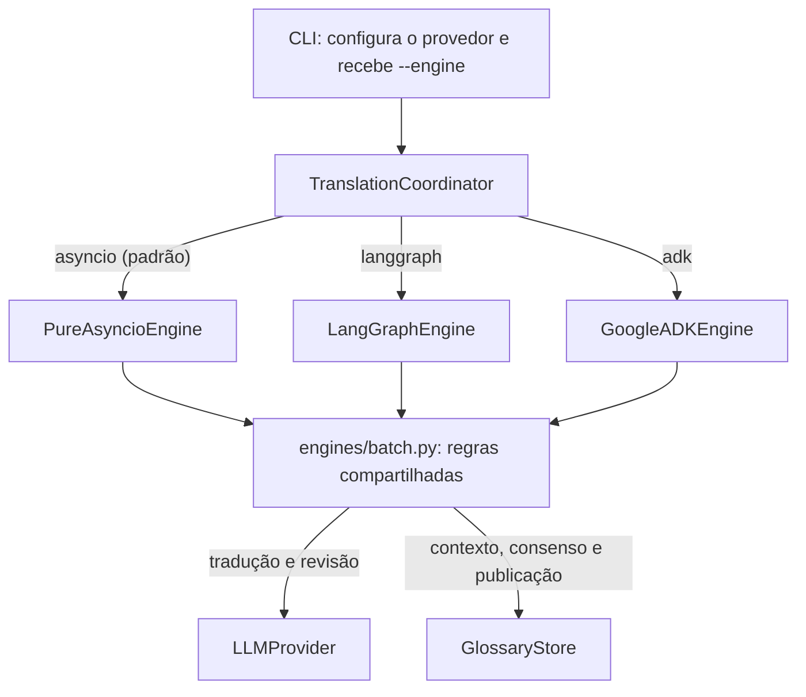
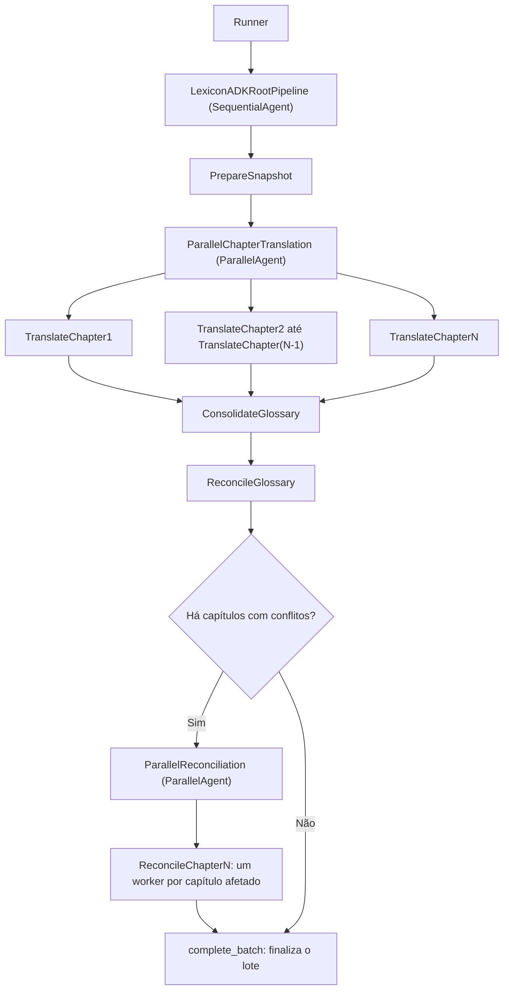
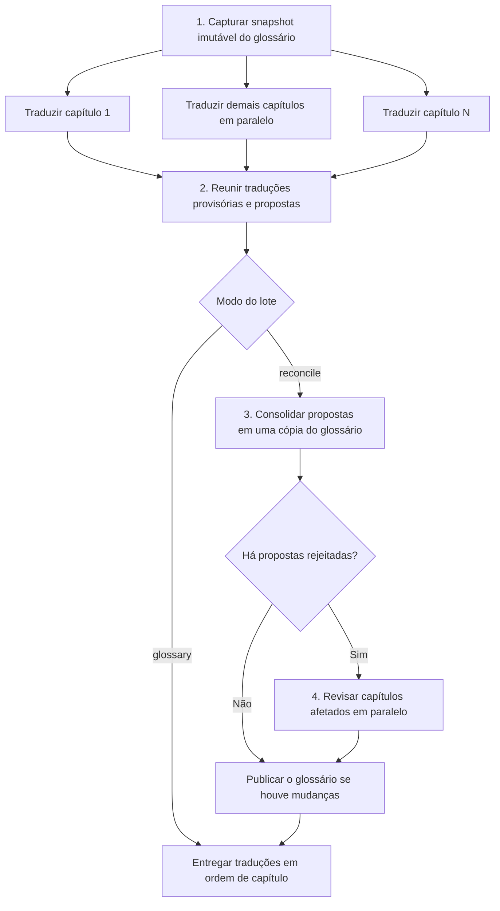

# Lexicon: Pipeline de Tradução Literária Ciente de Contexto com Consenso Lexical

> **Context-Aware Book Translation Pipeline with Lexical Consensus**  
> _(Origem do nome: **Lexi**con = **Lexi**cal **Con**sensus)_

**Autor** — Dangeles Lima

[Leia a amostra em EPUB dos capítulos I a III de Oz](output/wizard_of_oz_amostra_pt.epub) · [Reproduza a tradução local](#3-tradução-direta-de-livros-epub-comando-all-in-one-standalone)

[](README.md)
[](README.en.md)
[](https://www.python.org/)
[](tests/)
[-purple.svg>)](https://www.gutenberg.org/ebooks/55)

Pipeline assíncrono para tradução literária de livros inteiros (EPUB / Markdown $\rightarrow$ PT-BR) projetado para solucionar os dois maiores modos de falha da tradução automática convencional e de LLMs _zero-shot_:

1. **Deriva Terminológica entre Capítulos (_Cross-Chapter Lexical Drift_)**: Em obras longas traduzidas em paralelo sem estado compartilhado, o mesmo conceito do mundo recebe traduções divergentes ao longo dos capítulos (ex.: _Wizard_ $\rightarrow$ _bruxo_ no cap. 1, _mago_ no cap. 12, _sábio_ no cap. 18; _Golden Cap_ $\rightarrow$ _gorrete de ouro_ vs. _chapéu dourado_).
2. **Ambiguidade Morfossintática de Gênero (_Cross-Document Coreference & Gender Agreement_)**: O inglês não flexiona gênero em títulos, cargos e adjetivos predicativos (_"the ruler of the South was patient"_, _"the counselor of the North was cautious"_, _"the young traveler was exhausted"_). Tradutores sem memória de entidades assumem o masculino por padrão em português (_"o governante foi paciente"_, _"o jovem viajante estava exausto"_ para Glinda e Dorothy).

Demonstrado e avaliado sobre o corpus em domínio público **_The Wonderful Wizard of Oz_ (L. Frank Baum, 1900 — Project Gutenberg #55)**.

---

## Índice

- [Origem do Nome](#origem-do-nome)
- [Arquitetura modular e motores intercambiáveis](#arquitetura-modular-e-motores-intercambiáveis)
- [Protocolo de Consenso em 4 Fases](#protocolo-de-consenso-em-4-fases)
- [Por que Symbolic RAG em vez de Vector RAG?](#por-que-symbolic-rag-em-vez-de-vector-rag)
- [Estrutura do Projeto](#estrutura-do-projeto)
- [Resultados do Benchmark Multi-Engine (Ablation Study)](#resultados-do-benchmark-multi-engine-ablation-study)
- [Como Executar](#como-executar)
- [Aplicações Industriais Além de Livros](#aplicações-industriais-além-de-livros)
- [Apresentações de Slides (Meetup & Entrevistas)](#apresentações-de-slides-meetup--entrevistas)

---

## Origem do Nome

O nome **Lexicon** é um acrônimo de design de software:
$$\text{\textbf{Lexi}con} = \textbf{Lexi}\text{cal } \textbf{Con}\text{sensus}$$

Diferente de abordagens tradicionais que confiam cegamente em um único prompt longo ou em tradução sequencial lenta, o **Lexicon** modela a coerência do livro como um problema de **consenso lexical**. Os capítulos são traduzidos em paralelo a partir do mesmo snapshot imutável do glossário. Uma etapa central de consolidação define o vocabulário canônico.

---

## Arquitetura modular e motores intercambiáveis

O Lexicon é uma aplicação Python modular inspirada em **portas e adaptadores**. A separação aparece na integração com os modelos. Os motores chamam o contrato `LLMProvider`, definido em `contracts.py`, e a CLI fornece um adaptador compatível com a API da OpenAI ou com o LM Studio.

- **Domínio.** `models.py` define os dados do pipeline. `glossary.py` recupera o contexto lexical e resolve conflitos de terminologia. `evals.py` calcula as métricas de avaliação.
- **Coordenação.** `cli.py` recebe as opções e monta o provedor. O `TranslationCoordinator`, em `pipeline.py`, instancia o motor concreto escolhido por `--engine` e delega o lote a ele.
- **Orquestração.** `engines/batch.py` reúne a lógica compartilhada de tradução, consolidação, reconciliação e montagem do resultado. Cada motor organiza a execução dessas etapas com seu próprio mecanismo de concorrência.
- **EPUB.** `translate_epub.py` coordena extração, tradução e reconstrução. O pacote `epub/` gerencia o mapa `_chapters.json`, o alinhamento de parágrafos e a montagem do livro.

`asyncio` é o motor padrão e usa semáforos e `asyncio.gather`. `langgraph` usa um `StateGraph` com distribuição dinâmica de capítulos via `Send()`. `adk` organiza as etapas com agentes sequenciais e paralelos. LangGraph e ADK têm implementações locais de fallback para ambientes sem os extras correspondentes. `--concurrency` limita as chamadas simultâneas ao provedor dentro de cada lote nos três motores.

### Como o coordenador escolhe o motor



### Hierarquia de agentes no Google ADK

O `Runner` executa o agente raiz. Para um lote com N capítulos, o ADK cria N agentes de tradução, um por capítulo. Até `min(N, --concurrency)` agentes podem chamar o modelo ao mesmo tempo. A consolidação começa depois que todos publicam seus resultados no estado da sessão.



---

## Protocolo de Consenso em 4 Fases

1. **Preparação.** O motor captura um snapshot imutável do glossário. Com a injeção de contexto ativada, cada capítulo recebe os termos e personagens encontrados no seu texto por recuperação simbólica.
2. **Tradução em paralelo.** O provedor devolve uma tradução provisória e pode propor termos para o glossário.
3. **Consolidação.** As propostas são agrupadas pelo termo de origem normalizado. Uma entrada canônica existente tem prioridade. Para um termo novo, prevalece a proposta do capítulo de menor número. As mudanças ficam em uma cópia do glossário.
4. **Reconciliação.** O motor revisa apenas os capítulos com propostas rejeitadas e publica as mudanças no glossário após a revisão bem-sucedida.

O modo `glossary` mantém o glossário fixo e executa as duas primeiras etapas.



---

## Por que Symbolic RAG em vez de Vector RAG?

Modelos de embedding densos agrupam sinônimos e co-hipônimos na mesma vizinhança vetorial (_wizard_, _mage_, _sorcerer_ e _witch_ possuem similaridade de cosseno $> 0.90$). Buscar termos de glossário por similaridade vetorial introduz colisão semântica e induz o modelo ao erro.

O `GlossaryStore` utiliza **recuperação simbólica determinística com expansão morfológica** (`english_inflections` e `portuguese_inflections`):

- **Zero colisão de sinônimos**: Co-hipônimos permanecem estritamente disjuntos.
- **Economia de Tokens (-85%)**: Filtra um glossário de milhares de termos da obra para enviar apenas os 15–25 ativos no capítulo atual.
- **Latência Sub-Milissegundo**: Executa em memória em $< 1\text{ ms}$ por capítulo sem requisições externas de embedding.

---

## Estrutura do Projeto

```text
lexicon/
├── pyproject.toml
├── benchmarks/
├── docs/
├── examples/
├── output/
├── slides/
├── source/
├── tests/
└── src/lexicon/
    ├── cli.py
    ├── config.py
    ├── contracts.py
    ├── dataset.py
    ├── evals.py
    ├── glossary.py
    ├── local_consensus.py
    ├── local_translation.py
    ├── models.py
    ├── pipeline.py
    ├── translate_epub.py
    ├── engines/
    │   ├── batch.py
    │   ├── pure_asyncio.py
    │   ├── langgraph_engine.py
    │   ├── adk_engine.py
    │   ├── _langgraph_fallback.py
    │   └── _adk_fallback.py
    ├── epub/
    │   ├── alignment.py
    │   ├── builder.py
    │   ├── chapter_mapping.py
    │   ├── extractor.py
    │   ├── reflow.py
    │   └── xhtml.py
    └── providers/
        ├── local.py
        └── openai_compatible.py
```

O EPUB original de exemplo fica em `source/`, a amostra traduzida em `output/` e o glossário de Oz em `examples/`. Os scripts de benchmark e avaliação ficam em `benchmarks/`.

---

## Resultados do Benchmark Multi-Engine (Ablation Study)

O comando `python3 benchmarks/run_benchmark.py` usa um provedor simulado e três trechos curtos de teste inspirados em _The Wonderful Wizard of Oz_. As traduções e a contagem de tokens desta tabela são fixas.

```text
======================================================================================================
BENCHMARK MULTI-ENGINE (THE WONDERFUL WIZARD OF OZ, 1900) — CONSISTÊNCIA, GÊNERO & CHRF
======================================================================================================
Configuração & Engine                       | Aderência | Drift (H) |   Gênero |   chrF |  Tokens
------------------------------------------------------------------------------------------------------
1. Stateless Zero-Shot (Baseline)           |     25.0% | 1.5850 b |     0.0% |  84.32 |    1635
2. Static Context (Sem Reconciliação)       |     83.3% | 0.3962 b |   100.0% |  97.15 |    2175
3. Lexicon 4-Phase [Pure Asyncio]           |    100.0% | 0.0000 b |   100.0% | 100.00 |    3025
4. Lexicon 4-Phase [LangGraph StateGraph]   |    100.0% | 0.0000 b |   100.0% | 100.00 |    3025
5. Lexicon 4-Phase [Google ADK Hierarchy]   |    100.0% | 0.0000 b |   100.0% | 100.00 |    3025
======================================================================================================
```

### Gemma 4 local no LM Studio

O teste local usa os mesmos três trechos e referências em PT-BR. Os três modelos recebem os mesmos prompts, glossário inicial e fichas de personagens. O motor `asyncio` traduz os trechos com esse contexto, com a reconciliação desativada. O teste usa temperatura 0,2, uma requisição por vez, limite de 3.072 tokens de saída por chamada e respostas com esquema JSON.

Para reproduzir, inicie o servidor do LM Studio na porta 1234 e carregue um modelo de cada vez com janela de 8.192 tokens. Na raiz do projeto, passe ao script o identificador exibido por `lms ps`:

```bash
lms server start
lms load google/gemma-4-e4b -c 8192 --parallel 1
python3 benchmarks/run_benchmark.py --lm-studio-model google/gemma-4-e4b
lms unload google/gemma-4-e4b
```

Repita para `google/gemma-4-12b` e `google/gemma-4-26b-a4b-qat`. O tempo mede a execução do lote com o modelo já carregado.

**Resultados locais (12/11/2026)**

Uma execução por modelo no Apple M5 com 24 GB de memória, LM Studio 0.4.25+1 e modelos de 4 bits. Deriva zero indica ausência de variação entre as formas reconhecidas pelo avaliador. Consulte também a aderência, pois o avaliador não conta variantes desconhecidas na deriva.

| Modelo              | Aderência | Deriva (bits) | Gênero |  chrF | Tokens | Tempo (s) |
| ------------------- | --------: | ------------: | -----: | ----: | -----: | --------: |
| Gemma 4 E4B         |     75.0% |        0.0000 | 100.0% | 87.39 |   2200 |     16.81 |
| Gemma 4 12B         |     66.7% |        0.0000 |  57.1% | 85.26 |   2212 |     27.49 |
| Gemma 4 26B A4B QAT |     58.3% |        0.0000 |  57.1% | 69.68 |   2175 |     21.40 |

Os três modelos retornaram JSON válido para os três trechos. A revisão das respostas mostrou que o 26B traduziu o título do terceiro trecho, mas deixou os dois parágrafos em inglês. O 12B deixou uma palavra em inglês no segundo trecho, e o E4B trocou o gorro por uma coroa no terceiro. A validação do JSON e as métricas da tabela não garantem tradução integral ou fidelidade ao original.

O E4B teve a maior aderência e o maior chrF nesta rodada exploratória. Para comparar qualidade literária, é preciso testar capítulos completos, repetir as execuções e avaliar cobertura, fidelidade e fluidez sem identificar o modelo ao avaliador.

### Equações das Métricas Avaliadas

- **Taxa de Aderência ao Glossário (GAR %)**:
  $$\text{GAR} = \frac{\text{Termos Canônicos Usados Corretamente}}{\text{Total de Menções a Termos do Glossário}} \times 100$$
- **Entropia de Shannon de Deriva Lexical ($H(T \mid S)$ em bits)**:
  $$H(T \mid S = s) = -\sum_{t \in \mathcal{V}(s)} p(t \mid s) \log_2 p(t \mid s)$$
  _Um valor de $0.0000\text{ bits}$ indica que o avaliador não encontrou variação entre as formas que reconhece._
- **chrF (Popović, 2015)**: F-score de $n$-gramas de caracteres ($n \in \{1..6\}$, $\beta = 2$), métrica padrão para avaliar morfologia de línguas latinas como o português.

---

## Como Executar

### 0. Configuração de Chaves de API e Modelos (.env)

O Lexicon é **agnóstico a provedores de LLM**. Ele possui carregador automático de arquivos `.env` embutido (zero dependências externas). Basta copiar o template e preencher o provedor de sua preferência:

```bash
cp lexicon/.env.example lexicon/.env
```

#### Quais modelos o projeto suporta?

| Provedor / Runtime               | Endpoint Padrão                                           | Modelo Recomendado                  | Como Configurar no `.env`                                                                            |
| :------------------------------- | :-------------------------------------------------------- | :---------------------------------- | :--------------------------------------------------------------------------------------------------- |
| **LM Studio (Local / Gratuito)** | `http://localhost:1234/v1`                                | `google/gemma-4-e4b`                | `LLM_BASE_URL=http://localhost:1234/v1`<br>`LLM_API_KEY=lm-studio`<br>`LLM_MODEL=google/gemma-4-e4b` |
| **Ollama (Local / CLI)**         | `http://localhost:11434/v1`                               | `llama3.3:70b` / `qwen2.5:32b`      | `LLM_BASE_URL=http://localhost:11434/v1`<br>`LLM_API_KEY=ollama`<br>`LLM_MODEL=llama3.3:70b`         |
| **OpenAI (Cloud)**               | `https://api.openai.com/v1`                               | `gpt-4o-mini` _(padrão)_ / `gpt-4o` | `OPENAI_API_KEY=sk-...`<br>`LLM_MODEL=gpt-4o-mini`                                                   |
| **Google Gemini (Cloud)**        | `https://generativelanguage.googleapis.com/v1beta/openai` | `gemini-2.5-flash`                  | `GEMINI_API_KEY=AIzaSy...`<br>`LLM_MODEL=gemini-2.5-flash`                                           |
| **OpenRouter / DeepSeek**        | `https://openrouter.ai/api/v1`                            | `deepseek/deepseek-chat`            | `LLM_API_KEY=sk-or-...`<br>`LLM_BASE_URL=https://openrouter.ai/api/v1`                               |

> [!NOTE]
> **Modo Benchmark Offline:** O script sem `--lm-studio-model` usa um provedor simulado e roda sem um servidor de modelos. O modo LM Studio usa inferência local.

---

### 1. Testes Unitários e de Integração

```bash
PYTHONPATH=src python3 -m unittest discover -s tests -v
```

### 2. Executar o Benchmark Comparativo

```bash
python3 benchmarks/run_benchmark.py
```

### 3. Tradução Direta de Livros EPUB (Comando All-in-One Standalone)

O comando `translate-epub` extrai o livro, traduz as seções em paralelo e monta um novo EPUB. No modo LM Studio, o modelo recebe um parágrafo por pedido, com o glossário da seção, e devolve texto em português. Parágrafos muito longos são divididos. O Lexicon verifica respostas vazias, cortes e trechos copiados do inglês, e refaz o pedido quando necessário. Todos os modelos usam o mesmo fluxo. Os parágrafos aprovados voltam ao XHTML na ordem original.

```bash
# Tradução local com Gemma E4B. Execute a partir da raiz do projeto.
lms server start
lms load google/gemma-4-e4b -c 8192 --parallel 2
PYTHONPATH=src python3 -m lexicon.cli translate-epub \
  source/wizard_of_oz.epub -o output/wizard_of_oz_pt.epub \
  --lm-studio --model google/gemma-4-e4b --concurrency 2 \
  --glossary examples/oz_glossary.md --title "O Maravilhoso Mágico de Oz"

# Tradução completa de EPUB via OpenAI / Gemini (configurado no .env):
PYTHONPATH=src python3 -m lexicon.cli translate-epub \
  source/wizard_of_oz.epub \
  -o output/wizard_of_oz_pt.epub \
  --engine langgraph

# Operações modulares avulsas:
PYTHONPATH=src python3 -m lexicon.cli extract source/wizard_of_oz.epub -o en/wizard_of_oz
PYTHONPATH=src python3 -m lexicon.cli translate --source-dir en/wizard_of_oz --output-dir pt/wizard_of_oz --glossary pt/wizard_of_oz/glossary.md
PYTHONPATH=src python3 -m lexicon.cli build-epub pt/wizard_of_oz -o output/wizard_of_oz_pt.epub -s source/wizard_of_oz.epub
```

Num ambiente virtual Python, instale o projeto com `python3 -m pip install -e .` e use o identificador do modelo exibido por `lms ps`. Para testar só os capítulos I a III desse EPUB, acrescente `--sections 3 5`. As duas primeiras seções são a abertura e a introdução. A tradução local usa `--mode glossary` por padrão. Acrescente `--mode reconcile --glossary examples/oz_glossary.md` para detectar conflitos terminológicos e revisar os parágrafos afetados no mesmo comando. Ajuste `--concurrency` à quantidade de gerações simultâneas configurada no LM Studio.

O motor padrão é `asyncio`. Instale `.[langgraph]` ou `.[adk]` para experimentar os motores nativos. A CLI e o benchmark simulado identificam execuções com fallback.

O benchmark de trechos curtos acima mede o provedor anterior. A demonstração de EPUB usa o modo de tradução em blocos.

Os Gemma 4 E4B, 12B e 26B A4B QAT traduziram o capítulo I com o mesmo fluxo, glossário, temperatura de 0,2 e janela de 8.192 tokens. Com o E4B, os capítulos I a III geraram a [amostra em português](output/wizard_of_oz_amostra_pt.epub) em **3 min 16 s** num Apple M5 com 24 GB de memória e dois workers. Conferimos os 135 parágrafos no EPUB final, além dos títulos, dos links do sumário e do idioma da publicação.

---

### Benchmark de três capítulos completos no LM Studio

Três capítulos completos, com 135 parágrafos em cada saída. Todos os modelos usaram o LM Studio, asyncio, dois workers, temperatura 0,2 e janela de 8.192 tokens. A rodada foi feita em um Apple M5 com 24 GB, com um modelo de 4 bits carregado por vez.

```text
===============================================================================================================
BENCHMARK LM STUDIO / GEMMA 4 — OZ I–III — ASYNCIO, 2 WORKERS
===============================================================================================================
Gemma 4      | Configuração         | Aderência |   Deriva |          Gênero |   chrF |  Tokens | Tempo (s)
---------------------------------------------------------------------------------------------------------------
E4B          | Stateless Zero-Shot  |    41.67% | 0.5765 b |      100% (7/7) |  71.69 |   21483 |    192.22
E4B          | Static Context       |    91.67% | 0.0000 b |      100% (8/8) |  72.38 |   39829 |    197.52
E4B          | Lexicon 4-Phase      |    91.67% | 0.0000 b |      100% (8/8) |  72.38 |   40799 |    202.27
12B          | Stateless Zero-Shot  |    41.67% | 0.7289 b |      100% (8/8) |  72.79 |   22170 |    327.63
12B          | Static Context       |    91.67% | 0.0000 b |      100% (9/9) |  72.69 |   40567 |    349.39
12B          | Lexicon 4-Phase      |    91.67% | 0.0000 b |      100% (9/9) |  72.69 |   41558 |    357.51
26B A4B QAT  | Stateless Zero-Shot  |    58.33% | 0.2403 b |      100% (8/8) |  73.51 |   22243 |    172.77
26B A4B QAT  | Static Context       |    95.83% | 0.0000 b |      100% (7/7) |  73.88 |   40647 |    184.90
26B A4B QAT  | Lexicon 4-Phase      |   100.00% | 0.0000 b |      100% (7/7) |  73.87 |   41456 |    202.96
===============================================================================================================
```

Zero-Shot traduz sem glossário. Static Context recebe o glossário fixo. O 4-Phase parte da tradução de Static Context, coleta as formas usadas, consolida as propostas e reprocessa os parágrafos em conflito. Tokens e tempo do 4-Phase incluem a execução de Static Context e a etapa adicional, com a montagem do EPUB em ambas. O E4B, o 12B e o 26B registraram um conflito cada. A revisão só aumentou a aderência no 26B, que passou de 23/24 para 24/24.

A aderência usa 24 pares de parágrafo e termo. A deriva é a média da entropia de Shannon das variantes observadas por termo, com pelo menos 22 de 24 ocorrências reconhecidas por linha. Gênero mostra acertos sobre os casos com marca identificada em nove pontos anotados. O chrF é a média dos três capítulos, sem títulos ou legendas, contra a tradução de Rodrigo Pasa. [Livris — O Mágico de Oz](https://livris.com.br/livros/o-magico-de-oz/)

Use o mesmo modelo e as mesmas opções nas duas primeiras execuções. Para Zero-Shot, omita o glossário e use um diretório de trabalho novo. O terceiro comando consome os capítulos em Markdown da execução Static Context.

```bash
MODEL=google/gemma-4-e4b
lms server start
lms load "$MODEL" -c 8192 --parallel 2
COMMON=(source/wizard_of_oz.epub --model "$MODEL" --sections 3 5 --concurrency 2 --temperature 0.2)
GLOSSARY=examples/oz_glossary.md
time env PYTHONPATH=src python3 -m lexicon.cli translate-epub --lm-studio "${COMMON[@]}" \
  --work-dir /tmp/oz-zero -o /tmp/oz-zero.epub
time env PYTHONPATH=src python3 -m lexicon.cli translate-epub --lm-studio "${COMMON[@]}" \
  --glossary "$GLOSSARY" --work-dir /tmp/oz-static -o /tmp/oz-static.epub
time python3 benchmarks/reconcile_epub.py /tmp/oz-static/pt "${COMMON[@]}" \
  --glossary "$GLOSSARY" --work-dir /tmp/oz-four -o /tmp/oz-four.epub
curl -fL https://livris.com.br/download/o-magico-de-oz.epub -o /tmp/oz-reference.epub
python3 benchmarks/score_oz_matrix.py source/wizard_of_oz.epub /tmp/oz-four.epub \
  /tmp/oz-four/pt/_chapters.json "$GLOSSARY" /tmp/oz-reference.epub
lms unload "$MODEL"
```

---

## Demonstração Online & Modo BYOK

O plano completo de arquitetura para publicação da aplicação web (com streaming SSE, proteção de custos e suporte a **BYOK — _Bring Your Own Key_**) está documentado em:
👉 [**Guia de Arquitetura da Demonstração Online (com BYOK)**](docs/online_demo_architecture.md)

---

## Aplicações Industriais Além de Livros

A tradução literária de livros inteiros é apenas a demonstração mais acessível e rigorosa do protocolo de consenso. A mesma arquitetura de **Snapshot Isolation + Map-Reduce de IA + Reconciliação Determinística** aplica-se diretamente em problemas corporativos de missão crítica:

1. **Refatoração Massiva de Codebases**: Migração de monólitos ou atualização de bibliotecas em milhares de arquivos simultaneamente. Workers paralelos propõem contratos de funções e interfaces de API; um nó _single-writer_ consolida a interface pública canônica e o reconciliador ajusta os arquivos chamadores.
2. **Manuais Técnicos e Aeroespaciais (ISO/FAA)**: Manutenção de turbinas e sistemas de aeronaves com tolerância zero a desvios. A variação em termos críticos como _torque_, _valve_ e _seal_ é prevenida via _Symbolic RAG_ determinístico.
3. **LegalTech & Due Diligence em M&A**: Revisão concorrente de centenas de contratos complexos em fusões e aquisições, unificando definições canônicas (_Indemnification Cap_, nomes societários) sem colisão entre agentes auditores.
4. **Saúde & Ensaios Clínicos (Life Sciences)**: Padronização estrita de relatórios médicos multicêntricos submetidos à FDA e ANVISA, garantindo conformidade com ontologias regulatórias (SNOMED-CT, CID-11).

---

## Apresentações de Slides

- [Slides para meetup](slides/lexicon-meetup.pptx)
- [Slides para entrevistas técnicas](slides/lexicon-entrevista.pptx)
